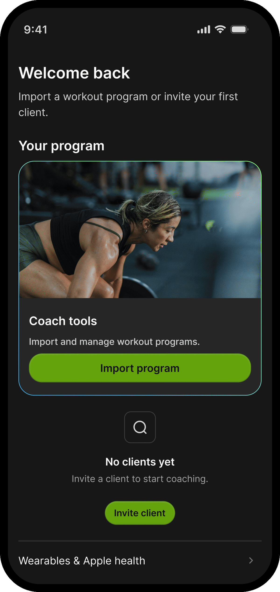

# repset-showcase
An independent iOS fitness app designed and built with AI-assisted development.

## About the product

Repset is a habit focused gym app for iOS. It guides members through personalized fitness journeys strength, endurance, fat loss, rehab, flexibility, and wellbeing. It also gives coaches a practice surface for clients, programs, and messaging. The experience is persona-driven. The same codebase shows different tabs and workflows depending on whether someone is training for themselves or coaching others.

## My role

I am building Repset end to end. Product direction, design, and native iOS engineering. That includes the design system, core member and coach journeys, logging and progress surfaces, and how features roll out.

## How I'm building it

My focus is not simply generating code, but understanding implementation tradeoffs, refining interactions, validating outcomes, and maintaining a coherent product experience.

- Native iOS: SwiftUI, SwiftData, iOS 17+
- Design-led: Figma is the visual source of truth; a shared design system (tokens, components, spacing hierarchy) keeps UI consistent in light and dark mode
- AI-assisted implementation: Cursor agents for design-to-code and presentation-layer diffs against Figma, without rewriting business logic
- Architecture: Persona gates, local-first persistence, free-tier / premium surfaces, and feature flags for social and accountability experiments
- Scope so far: Onboarding, Today, Train / Library, Core workouts, exercise & workout logging, Progress insights, HealthKit hooks, and a trainer suite (clients, programs, messaging)

## Product preview

  

  

## Status

Active private development. The commercial source code is maintained in a private repository. Core experiences are usable in-app. Design-system polish, sheet chrome, and social / accountability features are still iterating.
